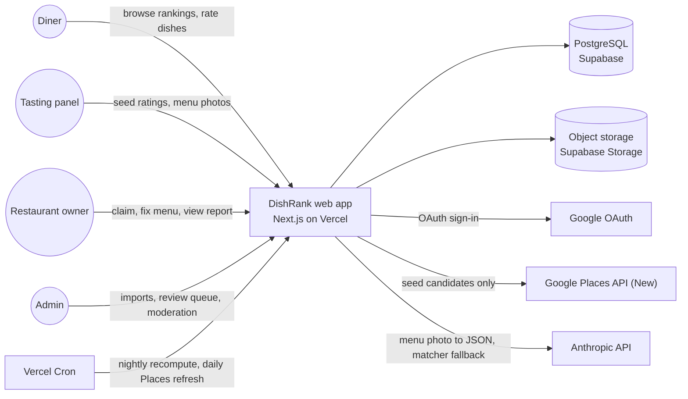
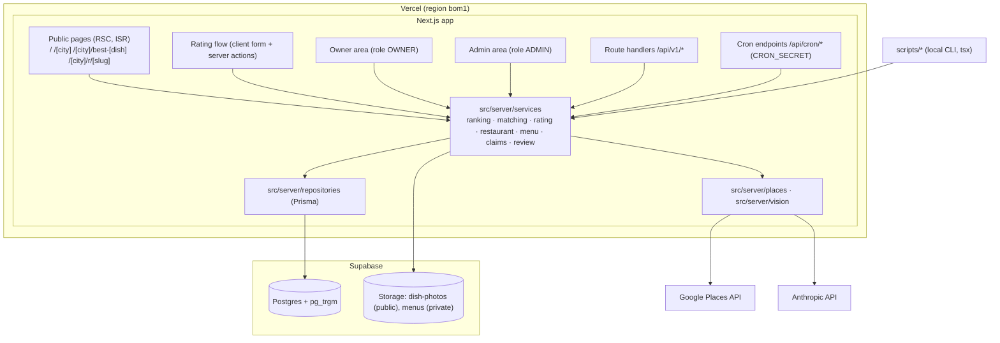
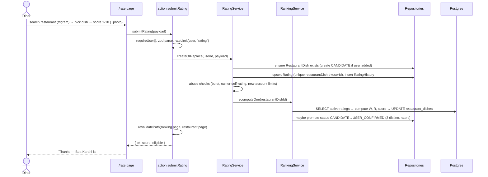
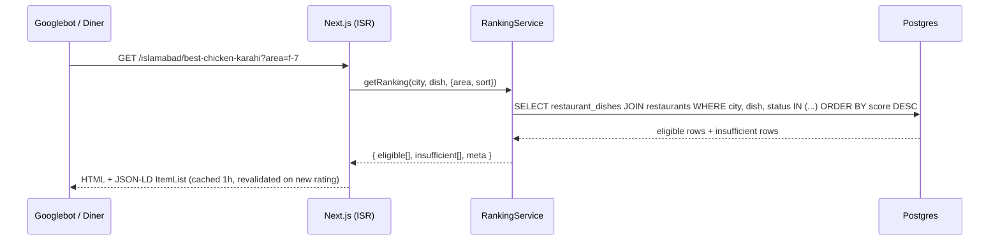
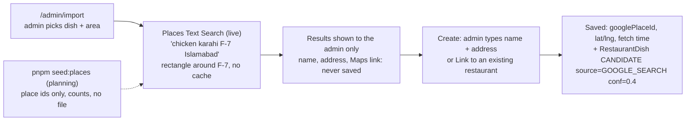
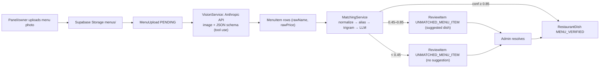
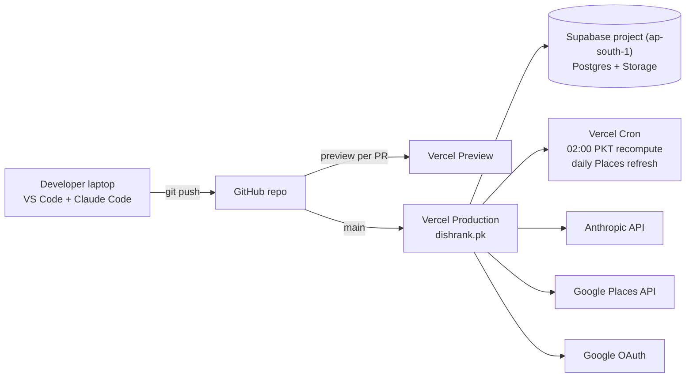

# 02 — Architecture

Diagrams are Mermaid. They render on GitHub and in VS Code with the "Markdown Preview Mermaid Support" extension. Standalone copies live in `docs/diagrams/*.mmd`.

## Principles

1. **One deployable.** A single Next.js app serves pages, server actions, JSON API, cron endpoints. No separate backend in v1.
2. **Services own logic.** Pages/actions/handlers are thin; `src/server/services/*` is the only place with business rules.
3. **Read-heavy, write-light.** Rankings are precomputed into `restaurant_dishes` aggregates; public pages are ISR.
4. **Own your data.** External APIs (Google Places, Anthropic) are used to *propose* data; humans or our own users *confirm* it.
5. **Everything auditable.** Rating history, review queue resolutions, status transitions are recorded.

## System context



## Containers



## Key flows

### Rating submission



### Ranking page render



### Candidate search (Google Places) — Google data shown, never saved



### Menu ingestion (photo → structured dishes)



### RestaurantDish lifecycle


Ranking eligibility is independent of status: a row ranks if `status IN (USER_CONFIRMED, MENU_VERIFIED, OWNER_VERIFIED)` **and** it meets the vote thresholds in docs/04. `CANDIDATE` rows appear only in "also serves (unverified)".

## Deployment



## Directory structure

```
dishrank/
├── CLAUDE.md
├── README.md
├── .env.example
├── .nvmrc                           # 24 (Node.js 24 LTS; package.json engines "24.x")
├── package.json  pnpm-lock.yaml  tsconfig.json  next.config.ts  vercel.json
├── postcss.config.mjs  components.json  eslint.config.mjs   # Tailwind 4 has no tailwind.config.ts; shadcn/ui config; ESLint flat config
├── prisma.config.ts                 # Prisma 7: schema path, migrations, seed command, CLI url = DIRECT_URL
├── prisma/
│   ├── schema.prisma
│   ├── migrations/
│   └── seed.ts                      # loads seed/*.json
├── seed/
│   ├── cities.json  areas.json  dishes.json  dish-categories.json  variant-tags.json  meat-words.json
├── docs/                            # the planning kit (specs, plans, prompts)
├── scripts/
│   ├── seed-places.ts               # planning: Places counts and call estimates (place ids only, no file)
│   ├── parse-menu.ts                # one MenuUpload → MenuItems + matching
│   └── recompute-rankings.ts        # calls RankingService.recomputeAll()
├── src/
│   ├── app/
│   │   ├── (public)/
│   │   │   ├── page.tsx                         # /
│   │   │   ├── [city]/page.tsx                  # /islamabad
│   │   │   ├── [city]/best-[dish]/page.tsx      # /islamabad/best-chicken-karahi
│   │   │   ├── [city]/r/[slug]/page.tsx         # restaurant page
│   │   │   ├── how-rankings-work/  dispute/  about/  privacy/  terms/
│   │   │   └── sitemap.ts  robots.ts
│   │   ├── (app)/
│   │   │   ├── rate/page.tsx                    # rating flow
│   │   │   ├── me/page.tsx
│   │   │   └── sign-in/page.tsx             # target of the signed-out redirect (?callbackUrl=)
│   │   ├── owner/  (layout.tsx and every page call requirePageRole)  claim/  restaurants/[id]/
│   │   ├── admin/  (layout.tsx and every page call requirePageRole)  import/  review/  restaurants/  users/  rankings/
│   │   ├── api/
│   │   │   ├── v1/ cities/ dishes/ rankings/ restaurants/ ratings/ restaurant-dishes/ flags/ uploads/ owner/ admin/
│   │   │   ├── cron/ recompute-rankings/ refresh-places/ mark-stale/   # mark-stale: manual only
│   │   │   └── auth/[...all]/           # Better Auth handler: toNextJsHandler(auth)
│   │   ├── layout.tsx  globals.css  not-found.tsx  error.tsx   # globals.css: @import "tailwindcss" + @theme tokens (Tailwind 4)
│   ├── components/
│   │   ├── ui/            # shadcn
│   │   ├── ranking/       # RankingList, RankingRow, EligibilityNote, FilterBar
│   │   ├── rating/        # RestaurantSearch, DishPicker, ScoreInput, PhotoUpload
│   │   ├── restaurant/    # RestaurantHeader, DishScoreList
│   │   ├── layout/        # Nav, Footer, CityPicker
│   │   ├── auth/          # Forbidden (shown to signed-in users without the role)
│   │   └── admin/         # import preview, restaurant forms, merge dialog (admin pages only)
│   ├── server/
│   │   ├── auth.ts                 # Better Auth instance (prismaAdapter, Google, nextCookies), requireUser(), requireRole()
│   │   ├── db.ts                   # Prisma client singleton on the @prisma/adapter-pg driver adapter
│   │   ├── errors.ts               # AppError
│   │   ├── rate-limit.ts           # DB-backed sliding window
│   │   ├── actions/                # submitRating, addRestaurantDish, flag, claim, admin*
│   │   ├── services/
│   │   │   ├── ranking.service.ts  # score math, eligibility, recomputeOne/All
│   │   │   ├── rating.service.ts
│   │   │   ├── matching/           # normalize.ts aliases.ts trigram.ts llm.ts index.ts
│   │   │   ├── restaurant.service.ts
│   │   │   ├── menu.service.ts
│   │   │   ├── claim.service.ts
│   │   │   └── review.service.ts
│   │   ├── repositories/           # *.repo.ts, Prisma only
│   │   ├── places/                 # textSearch.ts, placeDetails.ts (field masks)
│   │   ├── vision/                 # parseMenu.ts (Anthropic tool-use JSON schema)
│   │   └── validation/             # zod schemas shared by actions + API
│   ├── lib/                        # slug.ts, geo.ts (haversine), dates.ts, cn.ts
│   ├── generated/prisma/           # Prisma 7 client output (gitignored; `prisma generate`)
│   ├── env.ts                      # Zod-validated env; production fails fast at startup
│   ├── instrumentation.ts          # register() imports env.ts
│   └── types/
├── tests/
│   ├── unit/   matching/ ranking/ slug/ normalize/
│   └── e2e/    rate-flow.spec.ts  ranking-page.spec.ts  admin-review.spec.ts
└── tmp/        (gitignored) menu images for local parse
```

## Cross-cutting

| Concern | Decision |
|---|---|
| Auth | Better Auth (ADR-11): Google sign-in, Prisma adapter, database sessions. The session cookie cache stays off, so every check reads the session and `User.role` from the DB and role changes apply at once. `role` is a Better Auth additional field with `input: false`, so no client can set it. `requireUser()` / `requireRole(role)` in `src/server/auth.ts` wrap `auth.api.getSession({ headers })` and throw `AppError` 401/403; actions and handlers call them first. Admin/owner services take the current user (`actor`) as their first argument and call `requireRole` themselves, so a page that forgets its check still cannot read admin data. Layouts and every page under `admin/` and `owner/` call `requirePageRole(role)`: signed-out visitors are redirected to `/sign-in?callbackUrl=…`; signed-in users without the role see the `Forbidden` component (HTTP 200, `noindex`) and no admin data is fetched. Next.js `forbidden()` is not used because it is still experimental (`authInterrupts`). |
| Validation | Zod schemas in `src/server/validation`, shared by actions and API. |
| Rate limiting | `rate_limit_buckets` table, sliding window per `(key, action)`. Limits in docs/06. |
| Caching | Public pages `revalidate = 3600`; `revalidatePath` after rating write for the affected ranking + restaurant pages. Ranking pages never read `searchParams`: one cached page per city × dish, with area filter, sort and distance in the browser and city-wide rank numbers. |
| Geo | `lat/lng` columns; distance via haversine SQL expression; no PostGIS in v1 (ADR-5). |
| Search | `pg_trgm` GIN indexes on `restaurants.name`, `restaurants.search_text` and `dish_alias.alias` (one row per dish spelling; matched one alias at a time, docs/05). |
| Jobs | `/api/cron/*` secured by `Authorization: Bearer CRON_SECRET`, failing closed: 500 when the secret is unset, 401 on mismatch, constant-time compare. Idempotent; log run and external call counts in `job_runs`. Two scheduled crons: recompute (with stale marking) and the daily Places refresh. |
| Env | `src/env.ts` parses `process.env` with Zod. `src/instrumentation.ts` imports it in `register()`, so a production server with a missing or malformed required variable fails at startup; in development it logs the problems. Server code reads config only from `env`, never `process.env`. |
| Observability | Vercel logs + optional Sentry (free tier). Every service logs `{ action, userId, entityId, durationMs }`. |
| Images | Client resizes to ≤ 1600px and re-encodes through canvas before upload, which strips EXIF/GPS metadata. Dish photos go to the public `dish-photos` bucket under random cuid file names; menu photos go to the private `menus` bucket. Uploads use Supabase signed upload URLs (fixed 2 h validity, one path each) issued only by `/api/v1/uploads/sign`; the DB stores the path, not a URL. |
| i18n | English only; `lang="en"`; dish aliases carry Roman Urdu. |

## ADRs (architecture decision records)

| # | Decision | Why | Revisit when |
|---|---|---|---|
| ADR-1 | Single Next.js app, no separate API service | One deploy, server actions remove boilerplate, free tier | Native app needs its own API surface (then `/api/v1` already exists) |
| ADR-2 | Postgres + Prisma on Supabase | Relational data, trigram search, free tier, storage included | > 500 MB DB or need PostGIS |
| ADR-3 | TypeScript only in v1 (no Python) | One language, one toolchain | Heavy NLP batch work |
| ADR-4 | Google Places only to find candidates (shown, never saved); we keep just the place id and a ≤ 30-day location; humans type name and address | Policy compliance + data we own | Never |
| ADR-5 | No PostGIS; haversine on lat/lng | City-scale data, simpler Prisma | Multi-city nearby search at scale |
| ADR-6 | Ratings 1–10 + Bayesian score; pairwise votes deferred | Simple to explain, enough signal early | Phase 7 (pairwise/Bradley-Terry blend) |
| ADR-7 | Precomputed aggregates on `restaurant_dishes` | Ranking page is one indexed query | Need per-user personalised ranking |
| ADR-8 | ISR public pages + on-demand revalidation | SEO + speed on 3G | Real-time needs |
| ADR-9 | DB-backed rate limiting (no Redis) | Fewer services | Traffic > ~50 req/s |
| ADR-10 | Admin verifies owner claims manually | Trust > speed at launch | > 20 claims/week |
| ADR-11 | Better Auth replaces Auth.js v5: Google sign-in, Prisma adapter, database sessions, same roles and `requireUser()` / `requireRole()` | Auth.js v5 never left beta (`next-auth@5.0.0-beta.32` in Oct 2026) and is in maintenance under the Better Auth team; Better Auth 1.7 is stable and supports Next.js 16 and Prisma 7 | Phone OTP (Phase 7) or a native app needs another sign-in method |
| ADR-12 | Pinned versions: Node.js 24 LTS, Next.js 16 (stable), Prisma ORM 7 (latest stable 7.x, not the 8.0 release candidate that npm `latest` installs) | Node 20 is end-of-life; Next.js 16 is the current stable major; Prisma 7 needs `prisma.config.ts` and a driver adapter (`@prisma/adapter-pg`) | Prisma 8 is GA plus one patch release; Node 26 becomes the Vercel default |
