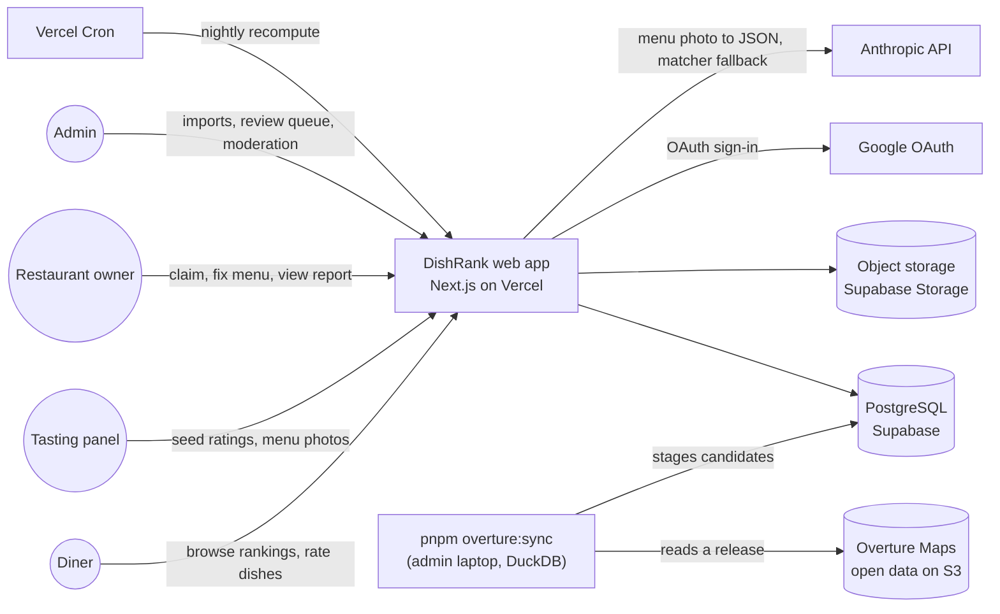
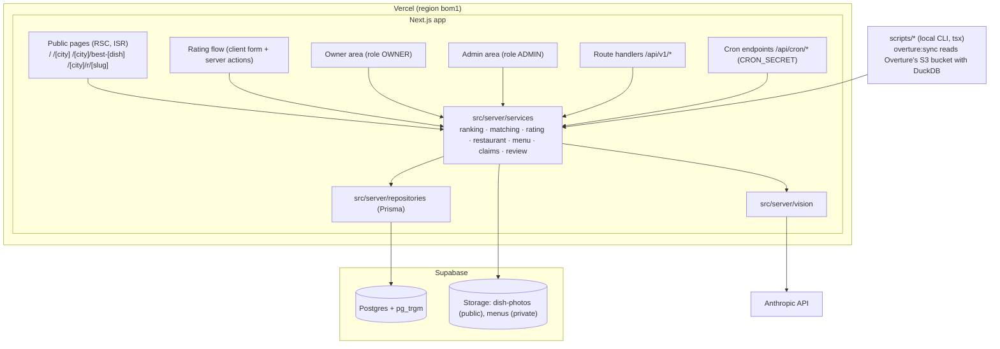
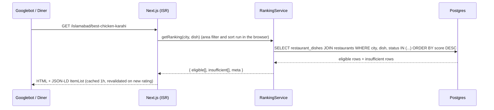
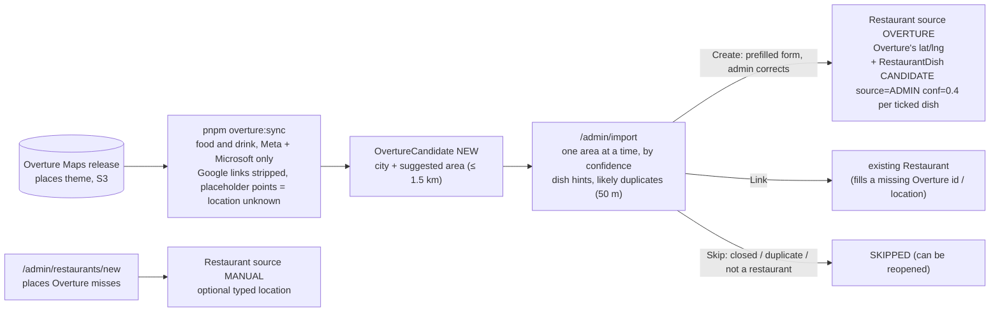
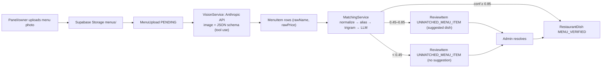
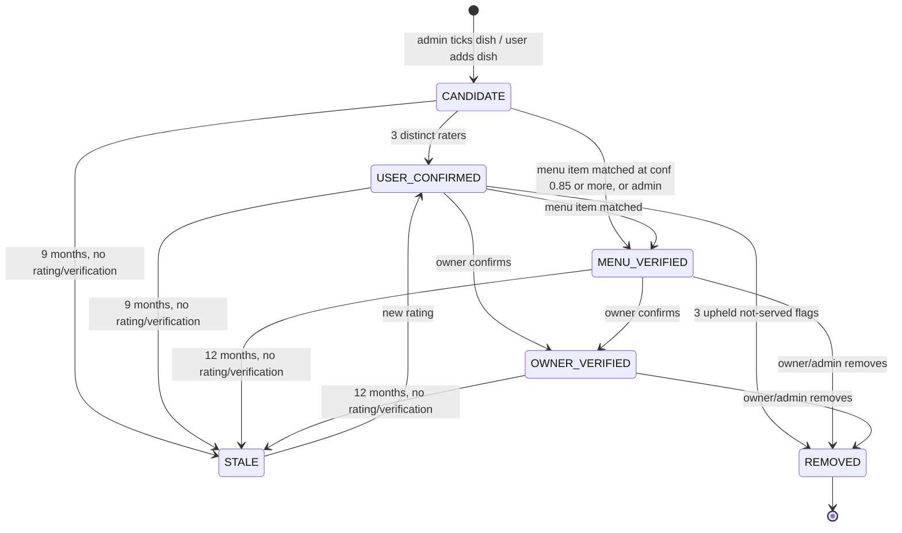
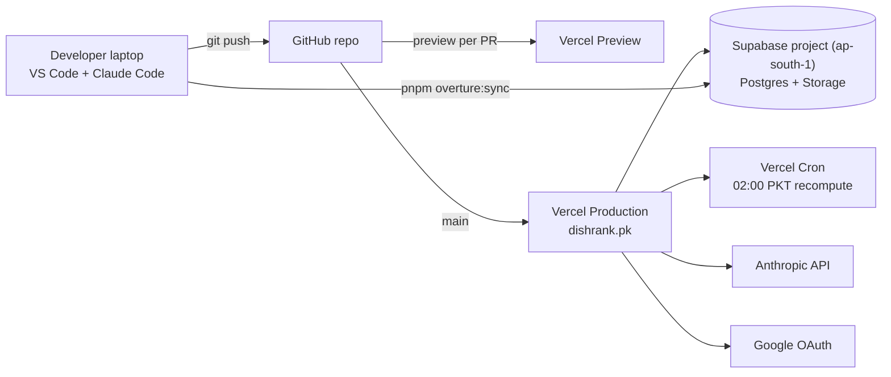

# 02 — Architecture

Diagrams are Mermaid. They render on GitHub and in VS Code with the "Markdown Preview Mermaid Support" extension. Standalone copies live in `docs/diagrams/*.mmd`.

## Principles

1. **One deployable.** A single Next.js app serves pages, server actions, JSON API, cron endpoints. No separate backend in v1.
2. **Services own logic.** Pages/actions/handlers are thin; `src/server/services/*` is the only place with business rules.
3. **Read-heavy, write-light.** Rankings are precomputed into `restaurant_dishes` aggregates; public pages are ISR.
4. **Own your data.** External sources (Overture Maps open data, the Anthropic API) only *propose* data; humans or our own users *confirm* it. No Google Places (ADR-13).
5. **Everything auditable.** Rating history, review queue resolutions, status transitions are recorded.

## System context



## Containers



## Key flows

### Rating submission

```mermaid
sequenceDiagram
  actor U as Diner
  participant P as /rate page
  participant A as action submitRating
  participant RS as RatingService
  participant RK as RankingService
  participant R as Repositories
  participant DB as Postgres
  U->>P: search restaurant (trigram) → pick dish → score 1-10 (+photo)
  P->>A: submitRating(payload)
  A->>A: requireUser(), zod parse
  A->>RS: createOrReplace(user, payload)
  RS->>R: checks: user not banned, restaurant ACTIVE and not the user's own, dish canonical, photo
  RS->>R: rate limits (per user, per restaurant; panel limits)
  RS->>R: one transaction: ensure RestaurantDish (CANDIDATE/USER), upsert Rating + RatingHistory, comment hold, burst rule
  RS->>RK: recomputeOne(restaurantDishId) after commit
  RK->>DB: SELECT counted ratings → W, R, score → UPDATE restaurant_dishes; promote CANDIDATE→USER_CONFIRMED at 3 raters
  RK->>DB: re-rank the (city, dish) list (rankInCity)
  A->>A: revalidatePath(ranking page, restaurant page)
  A-->>P: { score, votes, eligible, rank, ratingsNeeded, held }
  P-->>U: "8.3 · 23 votes · #3 in Islamabad" or "needs 2 more ratings to rank"
```

### Ranking page render



### Candidate import (Overture Maps) — every restaurant reviewed before it is public



### Menu ingestion (photo → structured dishes)



### RestaurantDish lifecycle



Ranking eligibility is independent of status: a row ranks if `status IN (USER_CONFIRMED, MENU_VERIFIED, OWNER_VERIFIED)` **and** it meets the vote thresholds in docs/04. `CANDIDATE` rows appear only in "also serves (unverified)".

## Deployment



## Directory structure

```
dishrank/
├── CLAUDE.md
├── README.md
├── .env.example
├── .nvmrc                           # 24 (Node.js 24 LTS; package.json engines "24.x")
├── package.json  pnpm-lock.yaml  tsconfig.json  next.config.ts  vercel.json
├── postcss.config.mjs  components.json  eslint.config.mjs   # Tailwind 4 has no tailwind.config.ts; shadcn/ui config; ESLint flat config
├── prisma.config.ts                 # Prisma 7: schema path, migrations, seed command, CLI url = DIRECT_URL
├── prisma/
│   ├── schema.prisma
│   ├── migrations/
│   └── seed.ts                      # loads seed/*.json
├── seed/
│   ├── cities.json  areas.json  dishes.json  dish-categories.json  variant-tags.json  meat-words.json
├── docs/                            # the planning kit (specs, plans, prompts)
├── scripts/
│   ├── overture-sync.ts             # stage Overture places as OvertureCandidate rows (docs/07 §1)
│   ├── lib/overture.ts              # DuckDB download + reader (shared with research/)
│   ├── research/overture-coverage.ts # the coverage report in docs/research/
│   ├── parse-menu.ts                # one MenuUpload → MenuItems + matching
│   ├── recompute-rankings.ts        # calls RankingService.recomputeAll()
│   └── dev-demo.ts                  # pnpm dev:demo [-- --undo]: local demo data (local databases only)
├── src/
│   ├── app/
│   │   ├── (public)/
│   │   │   ├── page.tsx                         # /
│   │   │   ├── [city]/page.tsx                  # /islamabad
│   │   │   ├── [city]/best-[dish]/page.tsx      # /islamabad/best-chicken-karahi
│   │   │   ├── [city]/r/[slug]/page.tsx         # restaurant page
│   │   │   ├── how-rankings-work/  dispute/  about/ (about/data: data sources and credits)  privacy/  terms/
│   │   │   ├── layout.tsx                       # public footer
│   │   │   └── sitemap.ts  robots.ts
│   │   ├── (app)/
│   │   │   ├── rate/page.tsx                    # rating flow
│   │   │   ├── me/page.tsx
│   │   │   └── sign-in/page.tsx             # target of the signed-out redirect (?callbackUrl=)
│   │   ├── owner/  (layout.tsx and every page call requirePageRole)  claim/  restaurants/[id]/
│   │   ├── admin/  (layout.tsx and every page call requirePageRole)  import/  review/  restaurants/  users/  rankings/
│   │   ├── api/
│   │   │   ├── v1/ cities/ dishes/ rankings/ restaurants/ ratings/ restaurant-dishes/ proposals/ location-observations/ me/ flags/ uploads/ owner/ admin/
│   │   │   ├── cron/ recompute-rankings/ mark-stale/   # mark-stale: manual only
│   │   │   └── auth/[...all]/           # Better Auth handler: toNextJsHandler(auth)
│   │   ├── layout.tsx  globals.css  not-found.tsx  error.tsx   # globals.css: @import "tailwindcss" + @theme tokens (Tailwind 4)
│   ├── components/
│   │   ├── ui/            # shadcn
│   │   ├── ranking/       # RankingList, RankingRow, EligibilityNote, FilterBar
│   │   ├── rate/          # RateFlow (search → dish → score → done), PhotoPicker, PanelLocationButton, SuggestForms
│   │   ├── me/            # DeleteRatingButton
│   │   ├── restaurant/    # RestaurantHeader, DishScoreList
│   │   ├── layout/        # Footer, OvertureCredit; Nav, CityPicker (Phase 4)
│   │   ├── auth/          # Forbidden (shown to signed-in users without the role)
│   │   └── admin/         # import review queue, Create form, restaurant forms, merge dialog (admin pages only)
│   ├── server/
│   │   ├── auth.ts                 # Better Auth instance (prismaAdapter, Google, nextCookies), requireUser(), requireRole()
│   │   ├── db.ts                   # Prisma client singleton on the @prisma/adapter-pg driver adapter
│   │   ├── errors.ts               # AppError
│   │   ├── rate-limit.ts           # DB-backed sliding window
│   │   ├── storage/                # StorageAdapter; Supabase Storage through S3 presigned URLs (sigv4.ts, ADR-14)
│   │   ├── actions/                # submitRating, addRestaurantDish, flag, claim, admin*
│   │   ├── services/
│   │   │   ├── ranking.service.ts  # score math, eligibility, recomputeOne/All
│   │   │   ├── rating.service.ts   # createOrReplace, deleteOwn: docs/04 abuse controls
│   │   │   ├── comment-screen.ts  proposal.service.ts  location.service.ts  upload.service.ts
│   │   │   ├── admin-users.service.ts  rate-page.service.ts
│   │   │   ├── dev-demo.service.ts # pnpm dev:demo (local only)
│   │   │   ├── matching/           # normalize.ts aliases.ts trigram.ts llm.ts index.ts
│   │   │   ├── restaurant.service.ts
│   │   │   ├── import.service.ts   # /admin/import review queue: Create / Link / Skip
│   │   │   ├── overture/           # places.ts (filters, area), duplicates.ts, dish-hints.ts (pure)
│   │   │   ├── overture-sync.service.ts  data-credits.ts
│   │   │   ├── menu.service.ts
│   │   │   ├── claim.service.ts
│   │   │   └── review.service.ts
│   │   ├── repositories/           # *.repo.ts, Prisma only
│   │   ├── vision/                 # parseMenu.ts (Anthropic tool-use JSON schema)
│   │   └── validation/             # zod schemas shared by actions + API
│   ├── lib/                        # slug.ts, geo.ts (haversine), dates.ts, cn.ts
│   ├── generated/prisma/           # Prisma 7 client output (gitignored; `prisma generate`)
│   ├── env.ts                      # Zod-validated env; production fails fast at startup
│   ├── instrumentation.ts          # register() imports env.ts
│   └── types/
├── tests/
│   ├── unit/   matching/ ranking/ rating/ restaurants/ import/ admin/ api/ storage/ dev-demo/ …
│   ├── e2e/    smoke.spec.ts  rate.spec.ts (360 px, real session cookie)  setup/prepare.ts
│   └── setup/  test database (dishrank_test): create, migrate, seed, reset
└── tmp/        (gitignored) menu images for local parse
```

## Cross-cutting

| Concern | Decision |
|---|---|
| Auth | Better Auth (ADR-11): Google sign-in, Prisma adapter, database sessions. The session cookie cache stays off, so every check reads the session and `User.role` from the DB and role changes apply at once. `role` is a Better Auth additional field with `input: false`, so no client can set it. `requireUser()` / `requireRole(role)` in `src/server/auth.ts` wrap `auth.api.getSession({ headers })` and throw `AppError` 401/403; actions and handlers call them first. Admin/owner services take the current user (`actor`) as their first argument and call `requireRole` themselves, so a page that forgets its check still cannot read admin data. Layouts and every page under `admin/` and `owner/` call `requirePageRole(role)`: signed-out visitors are redirected to `/sign-in?callbackUrl=…`; signed-in users without the role see the `Forbidden` component (HTTP 200, `noindex`) and no admin data is fetched. Next.js `forbidden()` is not used because it is still experimental (`authInterrupts`). |
| Validation | Zod schemas in `src/server/validation`, shared by actions and API. |
| Rate limiting | `rate_limit_buckets` table, sliding window per `(key, action)`. Limits in docs/06. |
| Caching | Public pages `revalidate = 3600`; `revalidatePath` after rating write for the affected ranking + restaurant pages. Ranking pages never read `searchParams`: one cached page per city × dish, with area filter, sort and distance in the browser and city-wide rank numbers. |
| Geo | `lat/lng` columns hold our own coordinates: from Overture (`locationSource OVERTURE`) or typed by an admin (`ADMIN`); NULL = location unknown. They are public data and drive the distance features (haversine, ADR-5). No PostGIS in v1. |
| Search | `pg_trgm` GIN indexes on `restaurants.name`, `restaurants.search_text` and `dish_alias.alias` (one row per dish spelling; matched one alias at a time, docs/05). |
| Jobs | `/api/cron/*` secured by `Authorization: Bearer CRON_SECRET`, failing closed: 500 when the secret is unset, 401 on mismatch, constant-time compare. Idempotent; log run and external call counts in `job_runs`. One scheduled cron: recompute (with stale marking). `pnpm overture:sync` runs by hand (monthly, after an Overture release) and logs a `JobRun` too. |
| Env | `src/env.ts` parses `process.env` with Zod. `src/instrumentation.ts` imports it in `register()`, so a production server with a missing or malformed required variable fails at startup; in development it logs the problems. Server code reads config only from `env`, never `process.env`. |
| Observability | Vercel logs + optional Sentry (free tier). Every service logs `{ action, userId, entityId, durationMs }`. |
| Concurrency | Writers take locks in one order: restaurant (a rating or a delete takes it shared; an edit, status change, merge or panel location exclusive, so each sees or waits for the others) → the (city, dish) list's advisory lock, in (city id, dish id) order when there are several (re-rank, merge) → dish rows in id order (a ban locks the rows of every rating it hides) → the user's rating → review item → user rows last, in id order (counters, ban, trust). Rating writes, deletes, admin decisions, panel locations, merges and trust updates all follow it. If two transactions still collide (deadlock or serialization failure), `inTransaction` tries once more and then answers `409 CONFLICT` ("try again"). |
| Images | Client resizes to ≤ 1600px and re-encodes through canvas before upload, which strips EXIF/GPS metadata. Dish photos go to the public `dish-photos` bucket under `<userId>/<random>.<ext>`; menu photos go to the private `menus` bucket. Uploads use presigned S3 `PUT` URLs for Supabase Storage (ADR-14: valid 10 minutes, one object key, content type signed) issued only by `/api/v1/uploads/sign`; a rating accepts a photo only after the server checked that the object exists, is at most 5 MB and is JPEG or WebP. The DB stores the path, not a URL. Without the `SUPABASE_S3_*` variables uploads are off and the rate flow hides the photo step. |
| i18n | English only; `lang="en"`; dish aliases carry Roman Urdu. |

## ADRs (architecture decision records)

| # | Decision | Why | Revisit when |
|---|---|---|---|
| ADR-1 | Single Next.js app, no separate API service | One deploy, server actions remove boilerplate, free tier | Native app needs its own API surface (then `/api/v1` already exists) |
| ADR-2 | Postgres + Prisma on Supabase | Relational data, trigram search, free tier, storage included | > 500 MB DB or need PostGIS |
| ADR-3 | TypeScript only in v1 (no Python) | One language, one toolchain | Heavy NLP batch work |
| ADR-4 | ~~Google Places only to find candidates~~ Superseded by ADR-13 (2026-10-25) | — | — |
| ADR-5 | No PostGIS; haversine on our own coordinates (Overture or admin-typed) | City-scale data, simpler Prisma | Multi-city nearby search at scale |
| ADR-6 | Ratings 1–10 + Bayesian score; pairwise votes deferred | Simple to explain, enough signal early | Phase 7 (pairwise/Bradley-Terry blend) |
| ADR-7 | Precomputed aggregates on `restaurant_dishes` | Ranking page is one indexed query | Need per-user personalised ranking |
| ADR-8 | ISR public pages + on-demand revalidation | SEO + speed on 3G | Real-time needs |
| ADR-9 | DB-backed rate limiting (no Redis) | Fewer services | Traffic > ~50 req/s |
| ADR-10 | Admin verifies owner claims manually | Trust > speed at launch | > 20 claims/week |
| ADR-11 | Better Auth replaces Auth.js v5: Google sign-in, Prisma adapter, database sessions, same roles and `requireUser()` / `requireRole()` | Auth.js v5 never left beta (`next-auth@5.0.0-beta.32` in Oct 2026) and is in maintenance under the Better Auth team; Better Auth 1.7 is stable and supports Next.js 16 and Prisma 7 | Phone OTP (Phase 7) or a native app needs another sign-in method |
| ADR-12 | Pinned versions: Node.js 24 LTS, Next.js 16 (stable), Prisma ORM 7 (latest stable 7.x, not the 8.0 release candidate that npm `latest` installs) | Node 20 is end-of-life; Next.js 16 is the current stable major; Prisma 7 needs `prisma.config.ts` and a driver adapter (`@prisma/adapter-pg`) | Prisma 8 is GA plus one patch release; Node 26 becomes the Vercel default |
| ADR-13 | No Google Places at all (2026-10-25). Restaurant candidates come from Overture Maps Places, Meta and Microsoft records only (CDLA Permissive 2.0), staged by `pnpm overture:sync` and reviewed one by one by an admin on /admin/import before anything is public; the Create form may prefill from Overture; restaurants keep Overture's coordinates as our own; /about/data carries the credit and the licence link | Google Maps Platform Terms 3.2.3(d)(iii) forbid using the Places API "in a listings or directory service", which DishRank is; Google also forbids saving names and addresses and caps stored coordinates at 30 days. Overture's open licence allows storing, changing and showing the data with a credit. AllThePlaces is left out (scraped, rule 1) and Foursquare too (Apache 2.0 notice duties); coverage and quality: docs/research/overture-coverage.md | Overture changes its licences or sources, or reviews show its records are too poor (then owner sign-ups and panel visits carry more of the load) |
| ADR-14 | Photo uploads through Supabase Storage's S3 protocol (2026-10-26): `/api/v1/uploads/sign` returns a SigV4 presigned `PUT` (`src/server/storage`, no AWS SDK) valid 10 minutes, with the content type signed; the server checks the object (HEAD) before a rating accepts it. Storage stays Supabase Storage | The owner asked for upload URLs valid ≤ 10 minutes; Supabase's own signed upload URLs are fixed at 2 hours on hosted projects, while S3 presigned URLs take any expiry. Needs four env vars (endpoint, region, access key id, secret) from the project's Storage settings | Supabase makes its own signed upload URLs' expiry configurable, or uploads move to a server-side proxy |
