# 03 — Data model

## ERD

```mermaid
erDiagram
  CITY ||--o{ AREA : has
  CITY ||--o{ RESTAURANT : has
  AREA ||--o{ RESTAURANT : locates
  DISH_CATEGORY ||--o{ DISH : groups
  DISH ||--o{ DISH_ALIAS : spelled_as
  RESTAURANT ||--o{ RESTAURANT_DISH : serves
  DISH ||--o{ RESTAURANT_DISH : offered_as
  RESTAURANT_DISH ||--o{ RATING : receives
  USER ||--o{ RATING : writes
  RATING ||--o{ RATING_HISTORY : logs
  RESTAURANT ||--o{ MENU_UPLOAD : has
  MENU_UPLOAD ||--o{ MENU_ITEM : contains
  DISH o|--o{ MENU_ITEM : matched_to
  RESTAURANT_DISH ||--o{ FLAG : flagged
  USER ||--o{ FLAG : raises
  RESTAURANT ||--o{ OWNER_CLAIM : claimed_via
  USER ||--o{ OWNER_CLAIM : submits
  USER o|--o{ REVIEW_ITEM : resolves
  CITY ||--o{ DISH_STAT : prior
  DISH ||--o{ DISH_STAT : prior
  CITY ||--o{ OVERTURE_CANDIDATE : stages
  AREA o|--o{ OVERTURE_CANDIDATE : suggested_for
  RESTAURANT o|--o{ OVERTURE_CANDIDATE : created_from_or_linked
  RESTAURANT ||--o{ LOCATION_OBSERVATION : observed_at
  USER ||--o{ LOCATION_OBSERVATION : records

  RESTAURANT {
    string id PK
    string slug
    string name
    string cityId FK
    string areaId FK
    string address
    float lat
    float lng
    enum locationSource
    string phone
    string website
    enum source
    string overtureId UK
    enum status
    int priceBand
  }
  OVERTURE_CANDIDATE {
    string id PK
    string overtureId UK
    string release
    string lastSeenRelease
    string cityId FK
    string suggestedAreaId FK
    string name
    string address
    float confidence
    float lat
    float lng
    enum status
    enum skipReason
    string restaurantId FK
  }
  DISH {
    string id PK
    string slug
    string name
    string categoryId FK
    bool isLaunch
  }
  DISH_ALIAS {
    string id PK
    string dishId FK
    string alias UK
  }
  RESTAURANT_DISH {
    string id PK
    string restaurantId FK
    string dishId FK
    string cityId
    string menuName
    int price
    string_array variantTags
    enum status
    enum source
    float confidence
    int ratingCount
    int distinctRaters
    float weightSum
    float weightedScoreSum
    decimal score
    int rankInCity
    datetime lastRatedAt
    datetime lastVerifiedAt
  }
  RATING {
    string id PK
    string restaurantDishId FK
    string userId FK
    int score
    int taste
    int portion
    int value
    string comment
    string photoPath
    enum status
    float weight
    datetime createdAt
  }
  USER {
    string id PK
    string email
    string username
    enum role
    float trustScore
    int ratingsCount
  }
```



## Prisma schema (authoritative — copy into `prisma/schema.prisma`)

```prisma
generator client {
  provider = "prisma-client" // Prisma 7 generator (prisma-client-js is deprecated)
  output   = "../src/generated/prisma" // required in Prisma 7; import PrismaClient from here
}

datasource db {
  provider = "postgresql"
  // Prisma 7 keeps connection URLs out of the schema:
  // - CLI (migrate, db seed): prisma.config.ts → datasource.url = env("DIRECT_URL")
  // - runtime: src/server/db.ts → new PrismaClient({ adapter: new PrismaPg({ connectionString: process.env.DATABASE_URL }) })
}

enum Role {
  USER
  OWNER
  ADMIN
}

enum RestaurantStatus {
  ACTIVE
  CLOSED
  DUPLICATE
  HIDDEN
}

enum RestaurantDishStatus {
  CANDIDATE
  USER_CONFIRMED
  MENU_VERIFIED
  OWNER_VERIFIED
  STALE
  REMOVED
}

enum SourceType {
  PANEL
  USER
  OWNER
  MENU_PHOTO
  ADMIN
}

enum RatingStatus {
  ACTIVE
  HELD
  HIDDEN
}

enum MenuUploadStatus {
  PENDING
  PARSED
  FAILED
  REVIEWED
}

enum MatchMethod {
  ALIAS
  TRIGRAM
  LLM
  HUMAN
  NONE
}

enum ReviewItemType {
  UNMATCHED_MENU_ITEM
  DISH_PROPOSAL
  RESTAURANT_PROPOSAL
  FLAG
  SUSPICIOUS_RATINGS
  OWNER_CLAIM
  DUPLICATE_RESTAURANT
  LOCATION_SUGGESTION
}

enum ReviewItemStatus {
  OPEN
  RESOLVED
  REJECTED
}

enum FlagReason {
  NOT_SERVED
  WRONG_DISH
  RESTAURANT_CLOSED
  DUPLICATE
  OTHER
}

enum ClaimStatus {
  PENDING
  APPROVED
  REJECTED
}

/// Where a restaurant record came from (OWNER arrives with owner sign-ups, Phase 6).
enum RestaurantSource {
  OVERTURE
  MANUAL
}

/// Where a restaurant's lat/lng came from.
enum LocationSource {
  OVERTURE
  ADMIN
  PANEL_GPS // an admin accepted a panel member's on-site location (docs/07 §7)
}

/// Review state of an Overture place (docs/07 §2).
enum CandidateStatus {
  NEW
  CREATED
  LINKED
  SKIPPED
}

enum CandidateSkipReason {
  CLOSED
  DUPLICATE
  NOT_A_RESTAURANT
}

// ---------- Auth (Better Auth) ----------
// User, Session, Account and Verification carry Better Auth's core fields (prismaAdapter, provider "postgresql").
// Better Auth runs with advanced.database.generateId = false, so ids come from these Prisma defaults like every other table.
// `role` is declared to Better Auth as user.additionalFields.role { type: "string", input: false, defaultValue: "USER" }:
// it is returned on the session user but can never be set by the client. The other app fields are invisible to Better Auth.
model User {
  id            String    @id @default(cuid())
  email         String    @unique
  emailVerified Boolean   @default(false)
  name          String // required by Better Auth; Google always sends a name
  image         String?
  username      String?   @unique
  role          Role      @default(USER)
  trustScore    Float     @default(0.6) // 0.3 .. 1.5, see docs/04
  isPanel       Boolean   @default(false) // admin-only (never Better Auth input); trust fixed at 1.3, panel limits in docs/04
  ratingsCount  Int       @default(0)
  photoRatings  Int       @default(0)
  bannedAt      DateTime?
  createdAt     DateTime  @default(now())
  updatedAt     DateTime  @updatedAt

  accounts             Account[]
  sessions             Session[]
  ratings              Rating[]
  flags                Flag[]
  claims               OwnerClaim[]
  menuUploads          MenuUpload[]
  resolvedItems        ReviewItem[]          @relation("resolver")
  createdItems         ReviewItem[]          @relation("creator")
  claimedRestaurants   Restaurant[]
  reviewedCandidates   OvertureCandidate[]
  locationObservations LocationObservation[]
}

model Account {
  id                    String    @id @default(cuid())
  accountId             String // the provider's user id (Google "sub")
  providerId            String // "google"
  userId                String
  accessToken           String?
  refreshToken          String?
  idToken               String?
  accessTokenExpiresAt  DateTime?
  refreshTokenExpiresAt DateTime?
  scope                 String?
  password              String? // Better Auth core field; unused (Google sign-in only)
  createdAt             DateTime  @default(now())
  updatedAt             DateTime  @updatedAt
  user                  User      @relation(fields: [userId], references: [id], onDelete: Cascade)

  @@unique([providerId, accountId])
  @@index([userId])
}

model Session {
  id        String   @id @default(cuid())
  token     String   @unique // value of the session cookie
  expiresAt DateTime
  ipAddress String?
  userAgent String?
  userId    String
  createdAt DateTime @default(now())
  updatedAt DateTime @updatedAt
  user      User     @relation(fields: [userId], references: [id], onDelete: Cascade)

  @@index([userId])
}

model Verification {
  id         String   @id @default(cuid())
  identifier String
  value      String
  expiresAt  DateTime
  createdAt  DateTime @default(now())
  updatedAt  DateTime @updatedAt

  @@index([identifier])
}

// ---------- Geography ----------
model City {
  id          String              @id @default(cuid())
  slug        String              @unique // islamabad, rawalpindi
  name        String
  lat         Float
  lng         Float
  launchedAt  DateTime? // NULL until an admin launches the city from /admin; bootstrap thresholds while NULL and for 60 days after
  areas       Area[]
  restaurants Restaurant[]
  dishStats   DishStat[]
  candidates  OvertureCandidate[]
}

model Area {
  id          String              @id @default(cuid())
  cityId      String
  slug        String // f-7, saddar
  name        String
  lat         Float
  lng         Float
  city        City                @relation(fields: [cityId], references: [id])
  restaurants Restaurant[]
  candidates  OvertureCandidate[]

  @@unique([cityId, slug])
}

// ---------- Restaurants ----------
model Restaurant {
  id              String           @id @default(cuid())
  slug            String           @unique
  name            String
  cityId          String
  areaId          String?
  address         String?
  lat             Float? // our own: from Overture or typed by an admin (locationSource); NULL = location unknown
  lng             Float?
  locationSource  LocationSource? // NULL exactly when lat/lng are NULL
  phone           String?
  website         String?
  priceBand       Int? // 1..4
  source          RestaurantSource // how the record was created; never changes
  overtureId      String?          @unique // GERS id of the Overture place it was created from or linked to
  status          RestaurantStatus @default(ACTIVE)
  aliases         String[]         @default([]) // other names typed by an admin ("but karahi"), docs/05
  searchText      String           @default("") // cleaned name + aliases, maintained by RestaurantService, for pg_trgm
  claimedByUserId String?
  claimedAt       DateTime?
  mergedIntoId    String? // set with status DUPLICATE; its URLs redirect permanently to this restaurant
  createdAt       DateTime         @default(now())
  updatedAt       DateTime         @updatedAt

  city                 City                  @relation(fields: [cityId], references: [id])
  mergedInto           Restaurant?           @relation("merge", fields: [mergedIntoId], references: [id])
  mergedFrom           Restaurant[]          @relation("merge")
  area                 Area?                 @relation(fields: [areaId], references: [id])
  claimedBy            User?                 @relation(fields: [claimedByUserId], references: [id])
  dishes               RestaurantDish[]
  menuUploads          MenuUpload[]
  claims               OwnerClaim[]
  reviewItems          ReviewItem[]
  candidates           OvertureCandidate[]
  locationObservations LocationObservation[]

  @@index([cityId, status])
  @@index([cityId, areaId])
  // Trigram index, created by the raw SQL migration after pg_trgm exists; declared here so Prisma does not drop it.
  @@index([searchText(ops: raw("gin_trgm_ops"))], type: Gin, map: "restaurants_search_trgm")
}

// ---------- Overture candidates (docs/07 §1-2) ----------
// Overture Maps places staged for admin review by `pnpm overture:sync`: food and drink places from
// Meta and Microsoft only (CDLA Permissive 2.0). A later release only adds GERS ids not seen before;
// existing rows keep their data and review state (only lastSeenRelease moves forward).
model OvertureCandidate {
  id               String               @id @default(cuid())
  overtureId       String               @unique // GERS id
  release          String // first Overture release that had it, e.g. 2026-10-21.0
  lastSeenRelease  String // newest synced release that still had it
  cityId           String // city of the nearest seed area centre
  suggestedAreaId  String? // nearest seed area centre within 1.5 km; NULL when farther or location unknown
  name             String
  address          String? // Overture's freeform address without Google links
  phone            String?
  website          String? // first website that is not a Google link
  category         String? // Overture taxonomy primary, e.g. pizza_restaurant
  alternates       String[]             @default([]) // Overture taxonomy alternates
  confidence       Float // Overture's existence score, 0..1 (relative, no threshold)
  lat              Float? // NULL = location unknown (Overture's point is a placeholder)
  lng              Float?
  sources          String[] // Overture datasets of the whole record: meta, Microsoft
  status           CandidateStatus      @default(NEW)
  skipReason       CandidateSkipReason?
  restaurantId     String? // CREATED or LINKED: the restaurant
  reviewedByUserId String?
  reviewedAt       DateTime?
  createdAt        DateTime             @default(now())
  updatedAt        DateTime             @updatedAt

  city          City        @relation(fields: [cityId], references: [id])
  suggestedArea Area?       @relation(fields: [suggestedAreaId], references: [id])
  restaurant    Restaurant? @relation(fields: [restaurantId], references: [id])
  reviewedBy    User?       @relation(fields: [reviewedByUserId], references: [id])

  @@index([cityId, status, suggestedAreaId])
  @@index([restaurantId])
}

// A panel member's browser location while rating at a restaurant (docs/07 §7). Kept apart from the
// rating, and only when the browser reports an accuracy of 50 m or better. Restaurants without a
// location, or far from it, get a LOCATION_SUGGESTION review item; accepting it sets PANEL_GPS.
model LocationObservation {
  id           String   @id @default(cuid())
  restaurantId String
  userId       String
  lat          Float
  lng          Float
  accuracyM    Float // browser-reported accuracy radius in metres (≤ 50)
  createdAt    DateTime @default(now())

  restaurant Restaurant @relation(fields: [restaurantId], references: [id], onDelete: Cascade)
  user       User       @relation(fields: [userId], references: [id], onDelete: Cascade)

  @@index([restaurantId, createdAt])
}

// ---------- Dish taxonomy ----------
model DishCategory {
  id        String @id @default(cuid())
  slug      String @unique
  name      String
  sortOrder Int    @default(0)
  dishes    Dish[]
}

model Dish {
  id          String   @id @default(cuid())
  slug        String   @unique
  name        String
  categoryId  String
  description String?
  isLaunch    Boolean  @default(false)
  createdAt   DateTime @default(now())

  category         DishCategory     @relation(fields: [categoryId], references: [id])
  aliases          DishAlias[]
  restaurantDishes RestaurantDish[]
  menuItems        MenuItem[]
  dishStats        DishStat[]
  reviewItems      ReviewItem[]
}

// One row per spelling of a dish; the dish name is stored as an alias too.
// Matching and dish search compare the query with one alias at a time (docs/05), never a concatenated string.
model DishAlias {
  id        String   @id @default(cuid())
  dishId    String
  alias     String   @unique // stored normalised (docs/05 step 1): lowercase ASCII words, single spaces
  createdAt DateTime @default(now())

  dish Dish @relation(fields: [dishId], references: [id], onDelete: Cascade)

  @@index([dishId])
  // Trigram index, created by the raw SQL migration after pg_trgm exists; declared here so Prisma does not drop it.
  @@index([alias(ops: raw("gin_trgm_ops"))], type: Gin, map: "dish_alias_trgm")
}

// ---------- The core join: restaurant serves dish ----------
model RestaurantDish {
  id               String               @id @default(cuid())
  restaurantId     String
  dishId           String
  cityId           String // denormalised for ranking queries
  menuName         String?
  price            Int? // PKR
  variantTags      String[]             @default([])
  status           RestaurantDishStatus @default(CANDIDATE)
  source           SourceType
  confidence       Float                @default(0.4)
  // aggregates maintained by RankingService
  ratingCount      Int                  @default(0)
  distinctRaters   Int                  @default(0)
  weightSum        Float                @default(0)
  weightedScoreSum Float                @default(0)
  rawMean          Decimal?             @db.Decimal(5, 3)
  score            Decimal?             @db.Decimal(5, 3)
  rankInCity       Int?
  lastRatedAt      DateTime?
  lastVerifiedAt   DateTime?
  createdAt        DateTime             @default(now())
  updatedAt        DateTime             @updatedAt

  restaurant Restaurant @relation(fields: [restaurantId], references: [id], onDelete: Cascade)
  dish       Dish       @relation(fields: [dishId], references: [id])
  ratings    Rating[]
  flags      Flag[]

  @@unique([restaurantId, dishId])
  @@index([cityId, dishId, status, score(sort: Desc)])
  @@index([dishId, status])
}

// ---------- Ratings ----------
model Rating {
  id               String       @id @default(cuid())
  restaurantDishId String
  userId           String
  score            Int // 1..10
  taste            Int? // 1..5
  portion          Int? // 1..5
  value            Int? // 1..5
  comment          String? // <= 280 chars
  photoPath        String?      @unique // storage path; one photo belongs to one rating (docs/06)
  status           RatingStatus @default(ACTIVE)
  weight           Float        @default(1) // rater's trustScore at write time, for the record only; scores use trust at compute time (docs/04)
  ipHash           String?
  createdAt        DateTime     @default(now())
  updatedAt        DateTime     @updatedAt

  restaurantDish RestaurantDish  @relation(fields: [restaurantDishId], references: [id], onDelete: Cascade)
  user           User            @relation(fields: [userId], references: [id])
  history        RatingHistory[]

  @@unique([restaurantDishId, userId])
  @@index([userId, createdAt])
  @@index([restaurantDishId, status, createdAt])
}

model RatingHistory {
  id        String   @id @default(cuid())
  ratingId  String
  score     Int
  comment   String?
  createdAt DateTime @default(now())
  rating    Rating   @relation(fields: [ratingId], references: [id], onDelete: Cascade)
}

// Phase 7 — pairwise votes (table created now, unused in v1)
model PairwiseVote {
  id         String   @id @default(cuid())
  dishId     String
  cityId     String
  winnerRdId String
  loserRdId  String
  userId     String
  createdAt  DateTime @default(now())

  @@index([cityId, dishId])
}

// ---------- Menus ----------
model MenuUpload {
  id               String           @id @default(cuid())
  restaurantId     String
  uploadedByUserId String
  filePath         String
  status           MenuUploadStatus @default(PENDING)
  rawJson          Json?
  error            String?
  createdAt        DateTime         @default(now())
  parsedAt         DateTime?

  restaurant Restaurant @relation(fields: [restaurantId], references: [id], onDelete: Cascade)
  uploadedBy User       @relation(fields: [uploadedByUserId], references: [id])
  items      MenuItem[]
}

model MenuItem {
  id              String      @id @default(cuid())
  menuUploadId    String
  rawName         String
  rawPrice        Int?
  rawSection      String?
  matchedDishId   String?
  matchConfidence Float? // docs/05: ALIAS 1.0 / 0.75 / 0.60 · TRIGRAM similarity, max 0.80 · LLM; ≥ 0.85 auto, 0.45–0.85 review with suggestions
  matchMethod     MatchMethod @default(NONE)
  variantTags     String[]    @default([])
  createdAt       DateTime    @default(now())

  menuUpload  MenuUpload @relation(fields: [menuUploadId], references: [id], onDelete: Cascade)
  matchedDish Dish?      @relation(fields: [matchedDishId], references: [id])
}

// ---------- Moderation ----------
model ReviewItem {
  id               String           @id @default(cuid())
  type             ReviewItemType
  status           ReviewItemStatus @default(OPEN)
  payload          Json // type-specific (see docs/07)
  restaurantId     String?
  dishId           String?
  createdByUserId  String?
  resolvedByUserId String?
  resolution       String?
  createdAt        DateTime         @default(now())
  resolvedAt       DateTime?

  restaurant Restaurant? @relation(fields: [restaurantId], references: [id])
  dish       Dish?       @relation(fields: [dishId], references: [id])
  createdBy  User?       @relation("creator", fields: [createdByUserId], references: [id])
  resolvedBy User?       @relation("resolver", fields: [resolvedByUserId], references: [id])

  @@index([status, type, createdAt])
}

model Flag {
  id               String         @id @default(cuid())
  restaurantDishId String
  userId           String
  reason           FlagReason
  note             String?
  upheld           Boolean?
  createdAt        DateTime       @default(now())
  restaurantDish   RestaurantDish @relation(fields: [restaurantDishId], references: [id], onDelete: Cascade)
  user             User           @relation(fields: [userId], references: [id])

  @@unique([restaurantDishId, userId, reason])
}

model OwnerClaim {
  id           String      @id @default(cuid())
  restaurantId String
  userId       String
  phone        String
  proofNote    String?
  status       ClaimStatus @default(PENDING)
  createdAt    DateTime    @default(now())
  reviewedAt   DateTime?
  restaurant   Restaurant  @relation(fields: [restaurantId], references: [id])
  user         User        @relation(fields: [userId], references: [id])

  @@index([status])
}

// ---------- Stats & ops ----------
model DishStat {
  cityId      String
  dishId      String
  meanScore   Float // city-wide weighted mean = Bayesian prior C
  ratingCount Int
  updatedAt   DateTime @updatedAt
  city        City     @relation(fields: [cityId], references: [id])
  dish        Dish     @relation(fields: [dishId], references: [id])

  @@id([cityId, dishId])
}

model RankingSnapshot {
  id         String   @id @default(cuid())
  cityId     String
  dishId     String
  computedAt DateTime @default(now())
  payload    Json // [{restaurantDishId, rank, score, votes}]

  @@index([cityId, dishId, computedAt])
}

model RateLimitBucket {
  key         String // e.g. "user:abc:rating"
  windowStart DateTime
  count       Int      @default(0)

  @@id([key, windowStart])
}

model JobRun {
  id         String    @id @default(cuid())
  name       String
  startedAt  DateTime  @default(now())
  finishedAt DateTime?
  ok         Boolean?
  summary    Json?
}
```

## Raw SQL migration (run after the first Prisma migration)

```sql
CREATE EXTENSION IF NOT EXISTS pg_trgm;
CREATE EXTENSION IF NOT EXISTS unaccent;
CREATE INDEX IF NOT EXISTS restaurants_search_trgm ON "Restaurant" USING gin ("searchText" gin_trgm_ops);
CREATE INDEX IF NOT EXISTS dish_alias_trgm ON "DishAlias" USING gin ("alias" gin_trgm_ops);
```

`DishAlias.alias` is written already normalised (seed and admin "create dish" both call `normalize()`). Trigram matching sets `pg_trgm.similarity_threshold = 0.45` per query, so the `%` operator uses `dish_alias_trgm` and returns only candidates at or above the docs/05 threshold. `Restaurant.searchText` is maintained by the service on write.

## Invariants (enforce in services + tests)

1. One active `Rating` per `(restaurantDishId, userId)`; a photo (`photoPath`, unique) belongs to one rating. Re-rating updates the row and appends `RatingHistory` (the previous score and comment, dated when that version was given). A re-rating keeps a `HELD` or `HIDDEN` status: only admins change it. `Rating.updatedAt` (the decay clock, docs/04) moves only when the user submits; status changes are written with plain SQL.
2. `RestaurantDish.cityId` always equals `restaurant.cityId`.
3. `RestaurantDish.score`, `rawMean` and `lastRatedAt` are `NULL` while no rating counts (`ratingCount = 0`); `rankInCity` is `NULL` unless eligible. `lastRatedAt` = the latest `updatedAt` of the counted ratings (ACTIVE, rater not banned).
4. Owner cannot rate dishes of a restaurant they claimed (`claimedByUserId == userId` → reject).
5. `User.trustScore` ∈ [0.3, 1.5].
6. A `Restaurant` with `status != ACTIVE` never appears in rankings or search.
6a. `Restaurant.mergedIntoId` is set if and only if `status = DUPLICATE`.
6b. `Restaurant.lat`, `lng` and `locationSource` are all NULL or all set. Coordinates are our own: from Overture (`OVERTURE`, only when the place is not on a placeholder point), typed by an admin (`ADMIN`), or a panel member's on-site location an admin accepted (`PANEL_GPS`). No Google data is stored anywhere (ADR-13).
6e. `LocationObservation` rows come only from panel members (checked on the server) with a browser accuracy of 50 m or better; they never sit on a `Rating`.
6f. `RestaurantDish.rankInCity` is set only by RankingService's re-rank (SQL eligibility, docs/04), which runs after every recompute, restaurant status change and merge.
6c. `Restaurant.source` never changes after creation. `OVERTURE` restaurants come from an `OvertureCandidate` reviewed on /admin/import; `MANUAL` ones were typed by an admin.
6d. `OvertureCandidate` rows are only added by `pnpm overture:sync` (one per GERS id, Meta and Microsoft records only, no Google links in `address` or `website`). A sync never changes an existing row except `lastSeenRelease`; review actions change only `status`, `skipReason`, `restaurantId`, `reviewedByUserId` and `reviewedAt`, and only from `NEW` (Reopen: `SKIPPED` → `NEW`).
7. `User.isPanel = true` implies `trustScore = 1.3`; only admins change `isPanel`.

## Seed files

- `seed/cities.json` — 2 cities with lat/lng.
- `seed/areas.json` — areas per city with lat/lng.
- `seed/dish-categories.json` — categories with sort order.
- `seed/dishes.json` — 84 dishes with aliases, category, `isLaunch` (see docs/05 for format). Each name and alias becomes a `DishAlias` row.
- `seed/variant-tags.json` — allowed variant tags, the words that map to them, and the size words stripped before matching.
- `seed/meat-words.json` — meat words per meat and the dish words that need a meat (docs/05 steps 2–3 and meat-word safety). Not stored in the DB.
